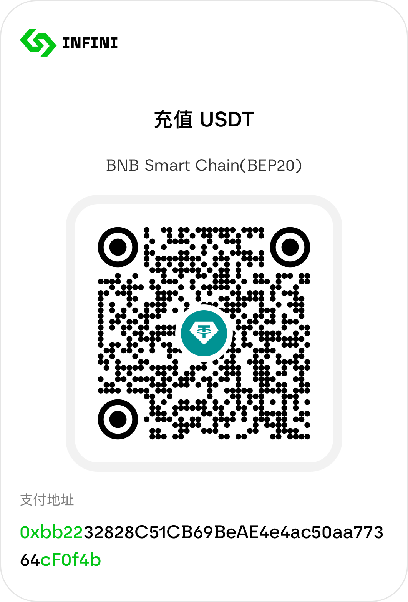

# Wire‑Pod for Armbian | China Edition

English · [简体中文](README.md)

This edition of [Wire‑Pod](https://github.com/kercre123/wire-pod) is adapted for users and network conditions in China. It runs in Docker on ARM64 Armbian hosts and provides local voice command services for Anki Vector 1.0 and 2.0.

## Features

- **Mandarin voice support.** Vosk defaults to Simplified Chinese speech recognition. Knowledge answers can be spoken in Mandarin offline, with optional Piper voices.
- **Custom language models.** In **Knowledge Graph Setup**, enter an OpenAI-compatible endpoint, model ID, and API key to connect providers such as Zhipu AI, Alibaba Qwen, or an Ollama instance on your local network.
- **Weather for Chinese cities.** Use Open‑Meteo without an API key, or configure a custom JSON weather endpoint with your choice of authentication, city, temperature units, and response field mappings. Vector keeps its original weather animations and spoken reports. Stock firmware typically delivers those reports in English.
- **Battery percentage.** Check Vector’s battery level as a percentage in the robot status page.
- **Docker deployment.** The default time zone is `Asia/Shanghai`. Docker volumes preserve pairing data and settings.

## Quick start

On an ARM64 Armbian host with Docker Engine and Docker Compose, run:

```bash
git clone https://github.com/1922558420/wirepod-armbian.git
cd wirepod-armbian
docker compose up -d --build
```

Open port `8080` on the server in your browser to complete Wire‑Pod setup and authenticate Vector. The first build and speech model download require access to the relevant container registries, source repositories, and model download sites. Enter API keys in the server’s settings page.

- [Armbian deployment, Mandarin voice, and custom weather setup](ARMBIAN.md)
- [Upstream installation and pairing guide](https://github.com/kercre123/wire-pod/wiki/Installation)

## Support this project



## Upstream and license

Based on [kercre123/wire-pod](https://github.com/kercre123/wire-pod) and distributed under the [MIT License](LICENSE). Thanks to Digital Dream Labs for open-sourcing Chipper and providing Escape Pod, and to bliteknight, dietb, fforchino, xanathon, and the other Wire‑Pod contributors.
