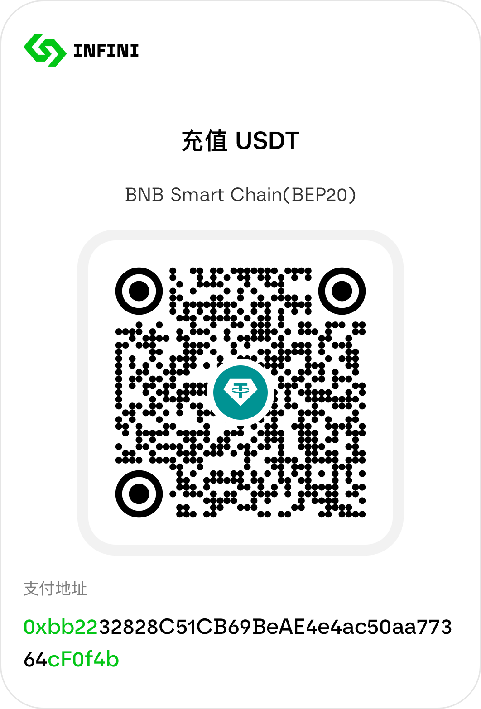

# Wire‑Pod Armbian 中国环境适配版

这是面向中国用户和国内网络环境修改的 [Wire‑Pod](https://github.com/kercre123/wire-pod)，适合在 Armbian ARM64 小主机上通过 Docker 部署。支持 Anki Vector 1.0 和 2.0，在局域网内提供语音指令服务。

## 国内环境适配

- **中文语音**：默认使用简体中文 Vosk 语音识别。知识问答支持离线普通话播报，可接入 Piper 改善音色。
- **自定义大模型**：可在 **Knowledge Graph Setup** 中填写 OpenAI 兼容的接口地址、模型 ID 和 API Key，接入智谱、通义千问或局域网内的 Ollama。
- **国内城市天气**：支持免密钥的 Open‑Meteo，也可自定义 JSON 天气接口的地址、鉴权、城市、温度单位和返回字段。天气继续使用 Vector 固件自带的播报和动画，原版固件通常以英文播报。
- **电池百分比**：在网页的机器人状态中查看 Vector 的电量百分比。
- **Docker 部署**：默认时区为 `Asia/Shanghai`。配对信息和运行设置保存在 Docker 卷中。

## 快速开始

在装有 Docker Engine 和 Docker Compose 的 Armbian 主机上运行：

```bash
git clone https://github.com/1922558420/wirepod-armbian.git
cd wirepod-armbian
docker compose up -d --build
```

用浏览器打开服务器的 `8080` 端口，完成 Wire‑Pod 初始化和 Vector 认证。首次构建和语音模型下载需要访问相应的镜像源、代码仓库和模型下载站。API Key 在服务器的配置页面填写。

- [Armbian 部署、中国语音与自定义天气配置](ARMBIAN.md)
- [上游安装和配对指南](https://github.com/kercre123/wire-pod/wiki/Installation)

## 支持本项目



## 上游与许可

基于 [kercre123/wire-pod](https://github.com/kercre123/wire-pod) 修改，沿用 [MIT 许可证](LICENSE)。感谢 Digital Dream Labs 开源 Chipper 并提供 Escape Pod，以及 bliteknight、dietb、fforchino、xanathon 和其他 Wire‑Pod 贡献者。
